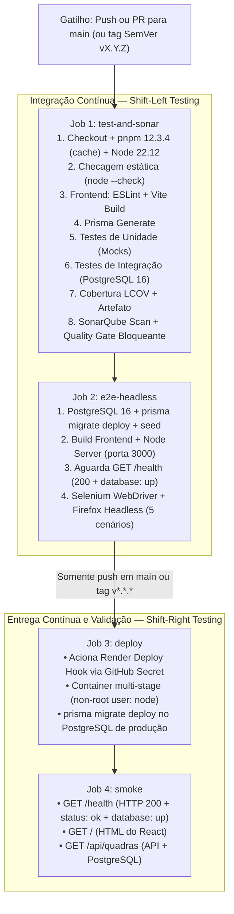

# Relatório Técnico — Implantação de DevOps, CI e CD (Projeto 05)

**Projeto:** Arena UFRN — Gestor de Reserva de Quadras de Areia  
**Grupo:** G3 — Paulo André Alves de Moura (`@pauloandrehxh`) e Luís Felipe Linhares Pereira (`@Luisfelipelinhares`)  
**Issue da disciplina (`bsi-tasks`):** [#627](https://github.com/tacianosilva/bsi-tasks/issues/627)  
**Repositório:** <https://github.com/pauloandrehxh/arena-ufrn>  
**Branch de entrega:** `infra/627-pipeline-ci-cd`

---

## 1. Visão Geral e Arquitetura da Esteira

A esteira de **Integração Contínua (CI)** e **Implantação Contínua (CD)** do Arena UFRN foi implementada em **GitHub Actions** ([`.github/workflows/backend-ci.yaml`](../.github/workflows/backend-ci.yaml)) e integra todos os níveis de verificação construídos ao longo da disciplina: checagem estática, lint, build do frontend, testes de unidade com mocks, testes de integração com PostgreSQL 16 real, testes de sistema E2E *headless*, cobertura de código, análise estática com **Quality Gate bloqueante no SonarQube LABENS**, publicação contínua containerizada na **Render** e **Smoke Test** pós-deploy.



### Descrição dos Estágios

| Estágio | Gatilho | Responsabilidade | Critério de Bloqueio |
|---|---|---|---|
| **Setup, Lint e Build** | Push e PR → `main` | Instala dependências com cache (`pnpm-lock.yaml`), executa `node --check` no backend, `eslint` e `vite build` no frontend | Falha em qualquer erro de sintaxe, lint ou build |
| **Testes de Unidade** | Push e PR → `main` | Executa suítes em `backend/tests/unit/` com isolamento de dependências via Mock Objects | Falha se qualquer teste unitário quebrar |
| **Testes de Integração** | Push e PR → `main` | Executa suítes em `backend/tests/integration/` contra um container **PostgreSQL 16** com schemas isolados por suíte (incluindo concorrência, RBAC, autenticação e `/health`) | Falha se qualquer contrato HTTP ou regra de persistência quebrar |
| **Cobertura e SonarQube** | Push e PR → `main` | Gera `backend/coverage/lcov.info`, publica artefato e envia ao **SonarQube LABENS** com `-Dsonar.qualitygate.wait=true` | **Bloqueante:** falha a esteira se o Quality Gate do SonarQube reprovar |
| **Testes de Sistema (E2E Headless)** | Push e PR → `main` (após `test-and-sonar`) | Sobe aplicação real (frontend compilado + API + PostgreSQL 16 + migrations + seed) e executa `frontend/e2e/home.e2e.test.js` com Selenium + Firefox *headless* | Falha se qualquer fluxo de usuário quebrar |
| **Deploy Contínuo (CD)** | Apenas `push` em `main` ou tag `v*.*.*` | Dispara o Deploy Hook da Render via GitHub Secret com o SHA exato do commit validado | Nunca dispara em Pull Requests nem se o CI falhar |
| **Smoke Test Pós-Deploy** | Após `deploy` | Executa requisições HTTP com retries contra `APP_URL/health`, `APP_URL/` e `APP_URL/api/quadras`, validando `200 OK` e `"database":"up"` | Reporta falha de deploy se a aplicação ou o banco não responderem |

---

## 2. Cultura DevOps e Testes Contínuos

A esteira construída materializa os pilares da cultura DevOps no contexto acadêmico do Arena UFRN:

1. **Eliminação de atritos entre desenvolvimento e operação:** anteriormente, o projeto usava SQLite local (`file:./dev.db`), o que causava divergência entre o ambiente local e produção e perda de dados em discos efêmeros. A padronização em **PostgreSQL 16** + **Prisma 7** + **Docker** garante que desenvolvimento local, CI e produção executem a mesma engine de banco e as mesmas migrations.
2. **Repetibilidade e segurança com containers:** o [`Dockerfile`](../Dockerfile) utiliza *multi-stage build* (separando build do React, instalação de dependências do backend e imagem final de runtime Alpine), executa com usuário sem privilégios de root (`USER node`) e inclui `HEALTHCHECK` nativo. O [`docker-compose.yml`](../docker-compose.yml) permite replicar toda a stack (`app` + `postgres`) com um único comando.
3. ***Shift-Left Testing* (prevenção antecipada):** a cada abertura ou atualização de Pull Request, testes rápidos de unidade, integração com PostgreSQL real, análise de cobertura/SonarQube e E2E *headless* executam automaticamente antes de qualquer merge, impedindo que regressões cheguem à `main`.
4. ***Shift-Right Testing* (confiança em produção):** após a publicação do container na Render, o endpoint `GET /health` valida não apenas o processo Node.js, mas também a conectividade real com o PostgreSQL (`SELECT 1`), retornando `200 OK` (`database: "up"`) ou `503 Service Unavailable` (`database: "down"`). O job `smoke` consome esse endpoint, a raiz HTML e `/api/quadras` automaticamente para confirmar que a nova versão está saudável no ar.

---

## 3. Ambiente Escolhido

Optamos pela **Opção B — Plataforma em Nuvem (Render)** com container Docker customizado e **PostgreSQL 16 gerenciado**:

- **Justificativa:** a equipe já havia validado o fluxo de deploy via Docker e webhook na Render na Tarefa 04, garantindo deploy contínuo zero-configuração com HTTPS automático, suporte a `render.yaml` (Infraestrutura como Código), health check nativo em `/health` e integração direta com PostgreSQL 16 gerenciado na mesma região (`Oregon`) via rede interna.
- **Arquitetura em produção:**
  - **Web Service (`arena-ufrn`):** container único construído a partir do `Dockerfile` multi-stage. O Express serve o bundle estático do React (`/app/public` com fallback SPA em `static-app.js`) e expõe a API REST em `/api/*` e o health check em `/health` na porta `10000`.
  - **Banco de Dados (`arena-ufrn-db`):** PostgreSQL 16 conectado via `DATABASE_URL` (Internal Database URL da Render). No startup do container, `prisma migrate deploy --config prisma7.config.ts` aplica automaticamente qualquer migration pendente antes de iniciar `node server.js`.
  - **Segurança de credenciais:** nenhuma senha, token ou URL de produção é versionada no repositório; segredos ficam exclusivamente nos **GitHub Secrets** e nas **Environment Variables** da Render.

---

## 4. Instruções de Configuração e Execução Local via Docker

### Variáveis de Ambiente e Secrets

| Variável / Secret | Onde configurar | Finalidade |
|---|---|---|
| `DATABASE_URL` | `backend/.env` / Render Env | String de conexão PostgreSQL 16 |
| `TEST_DATABASE_URL` | `backend/.env` / GitHub Actions | Banco PostgreSQL usado pelos testes de integração (schemas isolados) |
| `JWT_SECRET` | `backend/.env` / Render Env | Chave secreta (32+ chars) para assinatura JWT `HS256` |
| `CORS_ORIGINS` | `backend/.env` / Render Env | Origens permitidas para CORS com credenciais |
| `SONAR_TOKEN` | GitHub Secrets | Token de autenticação no SonarQube LABENS |
| `SONAR_HOST_URL` | GitHub Secrets | URL do servidor SonarQube (`https://labens.dct.ufrn.br/sonarqube`) |
| `RENDER_DEPLOY_HOOK_URL` | GitHub Secrets | Webhook seguro da Render para disparar deploy do commit testado |
| `APP_URL` | GitHub Variables | URL pública da aplicação para execução do Smoke Test |

### Replicando toda a aplicação localmente com Docker Compose

Pré-requisito: **Docker Desktop** (ou Docker Engine + Compose plugin).

```bash
# 1. Clonar o repositório
git clone https://github.com/pauloandrehxh/arena-ufrn.git
cd arena-ufrn

# 2. Subir PostgreSQL 16 + Aplicação (build multi-stage + migrations automáticas)
docker compose up --build -d

# 3. (Opcional, primeira execução) Popular gestor inicial e 3 quadras da UFRN
docker compose exec app node prisma/seed.js

# 4. Verificar saúde do servidor e banco PostgreSQL
curl http://localhost:3000/health
```

A aplicação completa (frontend + API) ficará acessível em `http://localhost:3000`.

- **Gestor padrão (seed):** `gestor@ufrn.br` / `Arena@123` (acesso a `/admin`)
- **Aluno demo (seed):** `aluno@ufrn.br` / `Arena@123` (acesso a `/minhas-reservas`)

Para encerrar os containers:
```bash
docker compose down
```

---

## 5. Links de Acesso

- **Aplicação publicada (Produção):** <https://arena-ufrn-dbsz.onrender.com>
- **Endpoint de Health Check (`/health`):** <https://arena-ufrn-dbsz.onrender.com/health>
- **Pipelines no GitHub Actions:** <https://github.com/pauloandrehxh/arena-ufrn/actions>
- **Painel no SonarQube LABENS:** <https://labens.dct.ufrn.br/sonarqube/dashboard?id=arena-ufrn>
- **Issue da P5 (`bsi-tasks`):** <https://github.com/tacianosilva/bsi-tasks/issues/627>

---

## 6. Evidências de Funcionamento

### 6.1 Testes Automatizados e Cobertura Local (PostgreSQL 16 Real)

Executado na branch `infra/627-pipeline-ci-cd`:
- `pnpm --dir backend run test:coverage`: **15/15 suítes aprovadas (226 testes passando)**, incluindo:
  - Testes unitários com mocks (`auth.service`, `password`, `quadra.service`, `usuario.service`, `reserva.service`, `reserva.cancelamento`);
  - Testes de integração em PostgreSQL 16 isolado por schema (`health.integration.test.js` validando `200`/`503` e `SELECT 1` real, `auth.integration.test.js` validando JWT/RBAC, `reservas.persistencia.test.js` com concorrência real via `pg_advisory_xact_lock`, `reservas.cancelamento.test.js` com trigger PL/pgSQL, `disponibilidade.integration.test.js`).
  - Cobertura em `src/services`: **> 92% Statements, 85% Branches, 100% Functions, > 94% Lines** (acima da meta de 80% do RNF06).
- `pnpm --dir frontend run lint` e `pnpm --dir frontend run build`: **0 erros e 0 warnings**.

### 6.2 Validação da Imagem Docker (Multi-Stage + Non-Root User)

- Build validado com `docker compose build app`.
- Confirmação de execução sem privilégios de root (`docker run --rm --entrypoint id arena-test-app`):
  ```text
  uid=1000(node) gid=1000(node) groups=1000(node)
  ```
- Validação do `docker compose up -d` com `GET http://localhost:3000/health` retornando HTTP `200`:
  ```json
  {"status":"ok","service":"arena-ufrn","database":"up","timestamp":"..."}
  ```

### 6.3 Pipeline CI/CD e Produção

- Os badges de status do **GitHub Actions** e do **Quality Gate do SonarQube LABENS** estão publicados no topo do [`README.md`](../README.md).
- Evidências históricas da implantação inicial na Render (T4) permanecem registradas em [`docs/evidencias/t4-cicd.md`](./evidencias/t4-cicd.md).
- Após a abertura e merge do PR da branch `infra/627-pipeline-ci-cd`, as execuções completas dos 4 jobs (`test-and-sonar`, `e2e-headless`, `deploy` e `smoke`) ficam auditáveis em <https://github.com/pauloandrehxh/arena-ufrn/actions>.
